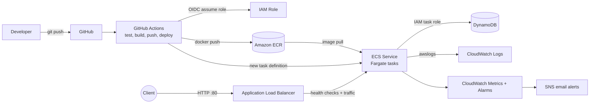

# Cloud-Native Task API on AWS: ECS Fargate, Terraform & GitHub Actions

[](https://github.com/YOUR_USERNAME/aws-ecs-fargate-devops-pipeline/actions/workflows/deploy.yml)


A production-style DevOps project that automates the full deployment lifecycle of a Python FastAPI
service on AWS. Code pushed to GitHub is automatically tested, built into a Docker image, pushed to
Amazon ECR and deployed to ECS Fargate behind an Application Load Balancer. Infrastructure is
defined in Terraform, authentication uses GitHub OIDC (no stored AWS keys), and CloudWatch provides
logs, dashboards and alarms with email alerts.

## Highlights

- **Fully automated delivery:** `git push` to `main` runs tests, builds, pushes and deploys with no manual steps.
- **Infrastructure as Code:** the whole AWS stack is created or destroyed with one Terraform command.
- **Secure by design:** GitHub OIDC instead of access keys, least-privilege IAM, containers reachable only through the ALB.
- **Self-healing deployments:** ECS deployment circuit breaker rolls back a bad release automatically.
- **Observable:** structured JSON logs, CloudWatch dashboard, 5 alarms, SNS email alerts.
- **Documented failures:** a troubleshooting runbook with root causes and fixes for 7 real failure scenarios.

## Architecture



## Tech stack

| Area | Technology |
|---|---|
| Application | Python 3.12, FastAPI, Pydantic, boto3 |
| Containers | Docker, Amazon ECR |
| Compute | Amazon ECS on AWS Fargate |
| Networking | Application Load Balancer, Security Groups, default VPC |
| Database | Amazon DynamoDB (on-demand) |
| IaC | Terraform |
| CI/CD | GitHub Actions with OIDC |
| Monitoring | CloudWatch Logs, Metrics, Alarms, Dashboard, SNS |
| Security | IAM (separate execution and task roles), ECR image scanning |

## Repository structure

```
.
├── app/                    # FastAPI application
│   ├── main.py             # routes, logging middleware, health checks
│   ├── models.py           # Pydantic models
│   └── database.py         # in-memory and DynamoDB repositories
├── tests/test_api.py       # pytest suite
├── Dockerfile
├── .github/workflows/
│   ├── deploy.yml          # test -> build -> push -> deploy
│   └── terraform-validate.yml
├── infrastructure/terraform/
│   ├── main.tf             # ECR, ECS, ALB, DynamoDB, IAM, OIDC
│   ├── monitoring.tf       # alarms, dashboard, SNS, budget
│   └── variables.tf / outputs.tf / versions.tf
└── docs/
    ├── deployment.md       # step-by-step deployment guide
    ├── troubleshooting.md  # failure scenarios and fixes
    └── screenshots/
```

## API

| Method | Endpoint | Description |
|---|---|---|
| GET | `/tasks` | List all tasks |
| GET | `/tasks/{id}` | Get one task |
| POST | `/tasks` | Create a task |
| PUT | `/tasks/{id}` | Update a task (partial updates supported) |
| DELETE | `/tasks/{id}` | Delete a task |
| GET | `/health` | Liveness check (used by the ALB) |
| GET | `/health/ready` | Readiness check (verifies DynamoDB) |

Interactive documentation is served at `/docs`.

**Example:**

```bash
curl -X POST http://<ALB_URL>/tasks \
  -H "Content-Type: application/json" \
  -d '{"title": "Learn AWS DevOps", "description": "Build cloud-native application"}'
```

```json
{
  "task_id": "3f1c9a52-...",
  "title": "Learn AWS DevOps",
  "description": "Build cloud-native application",
  "status": "pending"
}
```

## Run locally

```bash
python -m venv .venv && source .venv/bin/activate    # Windows: .venv\Scripts\activate
pip install -r requirements-dev.txt
pytest
uvicorn app.main:app --reload                        # http://localhost:8000/docs
```

With Docker:

```bash
docker build -t task-api .
docker run -p 8000:8000 task-api
```

Without `DYNAMODB_TABLE` set, the app uses an in-memory store. In AWS, Terraform sets it automatically.

## Deploy to AWS

Full guide: [docs/deployment.md](docs/deployment.md). Summary:

```bash
cd infrastructure/terraform
cp terraform.tfvars.example terraform.tfvars   # set github_repo and alarm_email
terraform init && terraform apply
```

Then add the `AWS_ROLE_ARN` and `AWS_REGION` variables in GitHub (Settings, Secrets and variables, Actions)
and push to `main`.

## CI/CD pipeline

1. **Test:** install dependencies, run pytest, build the Docker image.
2. **Authenticate:** GitHub requests a short-lived token and assumes the AWS deploy role through OIDC.
3. **Build and push:** image tagged with the commit SHA and `latest`, pushed to ECR.
4. **Deploy:** a new ECS task definition is rendered with the new image, and the service waits for stability.
5. **Rollback:** if new tasks fail health checks, the ECS circuit breaker restores the previous version.

## Monitoring and alerting

| Alarm | Trigger |
|---|---|
| CPU high | Service CPU above 80% for 10 minutes |
| Memory high | Service memory above 80% for 10 minutes |
| Unhealthy targets | ALB reports any unhealthy target |
| ALB 5xx | More than 5 server errors per minute for 3 minutes |
| Application errors | More than 5 ERROR log lines in 5 minutes |

Alarms notify by email through SNS. Logs are in `/ecs/task-api` and can be queried with CloudWatch Logs Insights.

## Security

- No long-lived AWS credentials: GitHub assumes a role through OIDC, trusted only for this repo's `main` branch.
- Two ECS roles: the execution role pulls images and writes logs; the task role can only access this one DynamoDB table.
- The service security group accepts traffic only from the ALB security group.
- The container runs as a non-root user, and ECR scans images on push.

## Troubleshooting

[docs/troubleshooting.md](docs/troubleshooting.md) covers: ALB 502, unavailable application, container crashes,
failed deployments, API 500 errors, database access failures and high CPU. Each entry lists the
symptom, how to reproduce it, how to investigate and the fix.

## Screenshots

<!-- Add your own images to docs/screenshots/ and uncomment -->
<!--


-->

## Cost

The main costs are the ALB (about $16-20 per month) and running Fargate tasks. No NAT Gateway is used.
Terraform creates a $10 monthly budget alert. Set `desired_count = 0` when idle, or run `terraform destroy`
when finished.

## What I learned

- How containers move from a laptop to a managed service, step by step.
- The difference between the ECS execution role and the task role, and why it matters for debugging.
- Why OIDC is safer than stored access keys.
- How to read ECS events, ALB target health and CloudWatch logs to find a root cause.

## Future improvements

- HTTPS with ACM certificate and a custom domain (Route 53)
- Private subnets with VPC endpoints
- ECS service auto scaling
- Terraform remote state (S3 with locking)
- Prometheus and Grafana dashboards
- Manual approval gate for production deploys

## License

MIT
