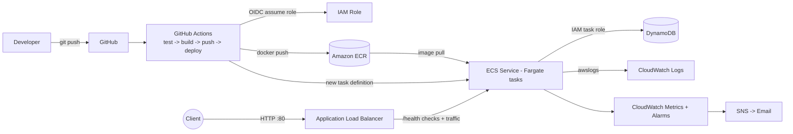

# Cloud-Native Task API on AWS (ECS Fargate + Terraform + GitHub Actions)

A FastAPI task-management REST API, containerized with Docker, deployed to **AWS ECS Fargate**
behind an **Application Load Balancer**, backed by **DynamoDB**, provisioned with **Terraform**,
shipped by **GitHub Actions (OIDC, no stored AWS keys)**, and monitored with **CloudWatch**
(logs, alarms, dashboard, SNS email alerts).

## Architecture



## API

| Method | Endpoint | Description |
|---|---|---|
| GET | `/tasks` | List tasks |
| GET | `/tasks/{id}` | Get one task |
| POST | `/tasks` | Create task |
| PUT | `/tasks/{id}` | Update task (partial) |
| DELETE | `/tasks/{id}` | Delete task |
| GET | `/health` | Liveness (used by ALB) |
| GET | `/health/ready` | Readiness (checks DynamoDB) |

Interactive docs at `/docs`.

## Run locally

```bash
python -m venv .venv && source .venv/bin/activate     # Windows: .venv\Scripts\activate
pip install -r requirements-dev.txt
pytest
uvicorn app.main:app --reload
```

Or with Docker:

```bash
docker build -t task-api .
docker run -p 8000:8000 task-api
curl -X POST localhost:8000/tasks -H "Content-Type: application/json" \
     -d '{"title":"Learn AWS DevOps","description":"Build cloud-native app"}'
```

Without `DYNAMODB_TABLE` set, the app uses an in-memory store. In AWS, Terraform sets `DYNAMODB_TABLE`.

## Deploy

See [docs/deployment.md](docs/deployment.md). Troubleshooting runbook: [docs/troubleshooting.md](docs/troubleshooting.md).

## Design decisions

- **GitHub OIDC** instead of access keys: short-lived credentials, role trust limited to this repo's `main` branch.
- **Two IAM roles for ECS**: execution role (pull image, write logs) vs task role (app access to ONE DynamoDB table only).
- **Default VPC, public subnets, no NAT Gateway**: avoids ~$32/month NAT cost; tasks only accept traffic from the ALB security group. A production setup would use private subnets.
- **Deployment circuit breaker with rollback**: a bad image rolls back automatically.
- **Liveness vs readiness endpoints**: the ALB only needs `/health`, so a DynamoDB blip doesn't cause the ALB to kill every task.
- **Immutable-by-SHA deploys**: every image is tagged with the commit SHA, so each deployment is traceable and rollbacks are easy.

## Cost

ALB (~$16-20/month) and Fargate are the main costs. Set `desired_count = 0` when idle, or run
`terraform destroy` when finished. A $10 monthly AWS Budget alert is created by Terraform.
